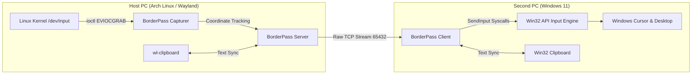

# BorderPass ⚡

<p align="center">
  
</p>

<p align="center">
  <strong>Ultra-low latency software KVM / KM switch for seamless mouse & keyboard sharing across Linux (Wayland) and Windows 11.</strong>
</p>

<p align="center">
  <a href="https://golang.org"></a>
  <a href="https://wails.io"></a>
  <a href="https://github.com/Reei-dp/BorderPass/releases"></a>
  <a href="LICENSE"></a>
  
</p>

---

## 🌟 Overview

**BorderPass** is designed for power users and developers working simultaneously on a **Linux (Wayland: Hyprland, Sway, GNOME, KDE)** primary workstation and a **Windows 11** secondary machine.

Move your mouse seamlessly across monitor borders as if they were a single continuous desktop — with near-zero latency (<0.5 ms over LAN), native hardware key mapping, and automatic clipboard text synchronization.

---

## ✨ Key Features

- **🚀 Ultra-Low Latency (<0.5 ms):** Custom compact 16-byte binary protocol streaming over raw TCP with `TCP_NODELAY`. No JSON/Protobuf overhead. Supports high-polling gaming mice (1000Hz+).
- **🛡️ Wayland Security Bypass:** Bypasses Wayland's compositor isolation at the Linux kernel level using `ioctl(EVIOCGRAB)` on `/dev/input/event*`. Works natively without X11 or sluggish desktop portals.
- **⚡ Native Win32 Injection:** Zero-CGO Windows injection using direct `SendInput` syscalls and layout-independent hardware scancodes.
- **📋 Intelligent Clipboard Synchronization:** Bidirectional text sync with MIME-type filtering. Preserves local image buffers so taking screenshots with flameshot/grim/Snipping Tool never gets overwritten.
- **🎨 Cyber-Terminal GUI:** Beautiful dark cyber aesthetic built with Wails v2:
  - Vector SVG neon branding (crisp across all screen scales and DPI).
  - Interactive **Drag & Snap** monitor arrangement canvas.
  - Live connection status, telemetry counters, and focus indicators.
- **🔁 Bi-directional Edge Switching:** Seamlessly switch to the second machine and return cursor focus instantly when touching the boundary.

---

## 🏗️ Architecture



---

## 📥 Installation & Download

Pre-compiled production binaries for Linux and Windows are available directly on the [**Releases**](https://github.com/Reei-dp/BorderPass/releases) page.

| Platform | Download | Requirements |
| :--- | :--- | :--- |
| **Linux (Host)** | `borderpass` | WebKitGTK (`webkit2gtk-4.1`), `wl-clipboard` |
| **Windows 11 (Client)** | `borderpass.exe` | Microsoft Edge WebView2 Runtime (preinstalled on Win 10/11) |

### Linux Permissions (One-Time Setup)

To allow BorderPass to capture input devices without `sudo`:

```bash
# Add current user to input group:
sudo usermod -aG input $USER

# Apply group changes immediately:
newgrp input
```

---

## 🚀 Quick Start

### 1. Launch on Host PC (Linux)
Run the application:
```bash
./borderpass
```
1. Click **[ CONTINUE ]** on the splash screen.
2. Select **HOST PC**.
3. Drag the **SECOND PC** monitor on the canvas to match your physical desk layout (Left, Right, Top, or Bottom).
4. Take note of the **IP** and **Port** shown (e.g. `192.168.1.17:65432`).

### 2. Launch on Second PC (Windows)
Run `borderpass.exe`:
```powershell
.\borderpass.exe
```
1. Click **[ CONTINUE ]**.
2. Select **SECOND PC**.
3. Enter your Host PC's IP and Port.
4. Click **[ ▶ CONNECT TO HOST ]**.

✨ **Done!** Push your cursor past your screen border towards the second computer to take control.

---

## 🛠️ Building from Source

### Prerequisites
- [Go 1.24+](https://golang.org/dl/)
- [Node.js & npm](https://nodejs.org/)
- [Wails CLI v2](https://wails.io/docs/gettingstarted/installation):
  ```bash
  go install github.com/wailsapp/wails/v2/cmd/wails@latest
  ```

### Build for Linux:
```bash
# Install WebKitGTK headers (Arch Linux):
sudo pacman -S webkit2gtk-4.1

# Build binary:
wails build -tags webkit2_41
# Output binary: build/bin/borderpass
```

### Build for Windows (Cross-compiling from Linux):
```bash
wails build -platform windows/amd64
# Output binary: build/bin/borderpass.exe
```

---

## ⌨️ Headless / CLI Mode

BorderPass can also run in pure headless terminal mode (ideal for background systemd services or automated startup):

```bash
# Host mode (Linux):
./borderpass --cli --server --pos right --addr :65432

# Client mode (Windows / Linux):
./borderpass --cli --client --addr 192.168.1.17:65432
```

---

## 🔒 Security & Privacy

- BorderPass connects directly over your local private network (LAN/Wi-Fi).
- Input data is never sent to external servers or telemetry endpoints.
- Binary packet headers prevent unauthorized data injection.

---

## 📄 License

Distributed under the **MIT License**. See [LICENSE](LICENSE) for more details.
